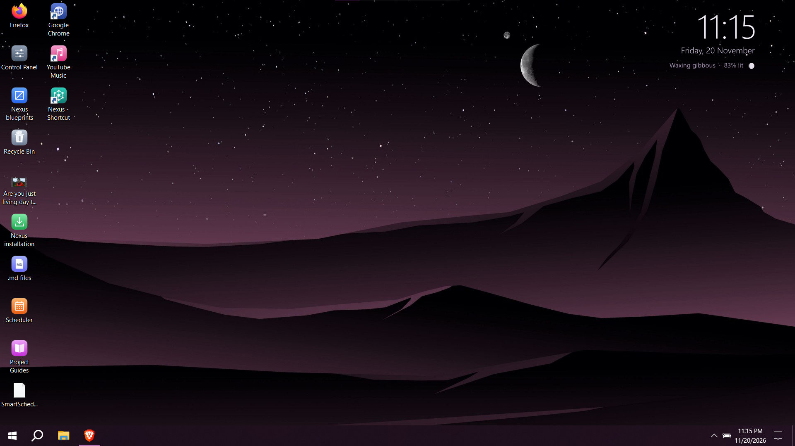
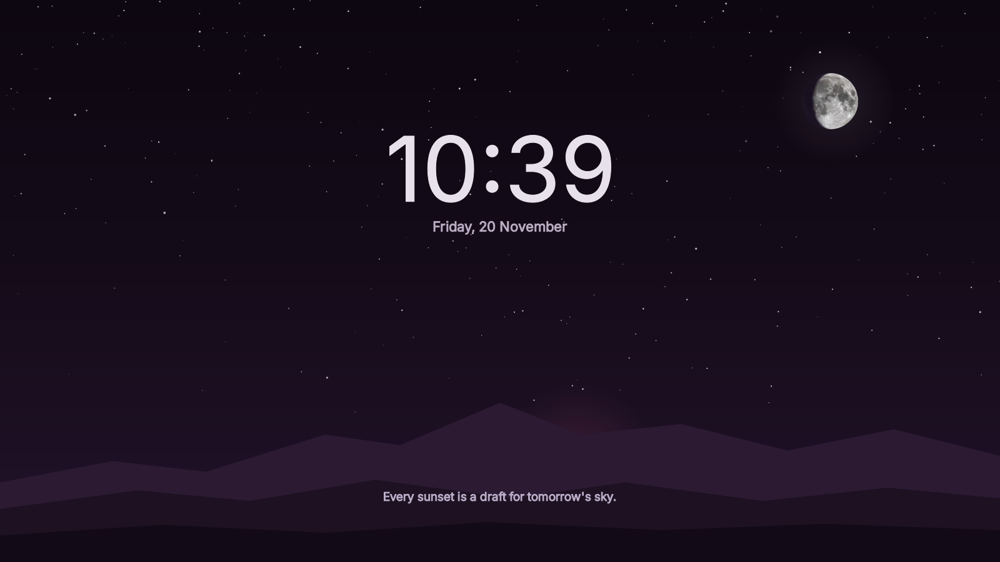
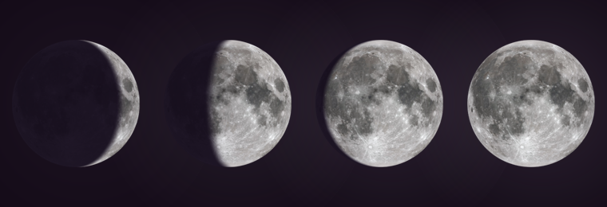
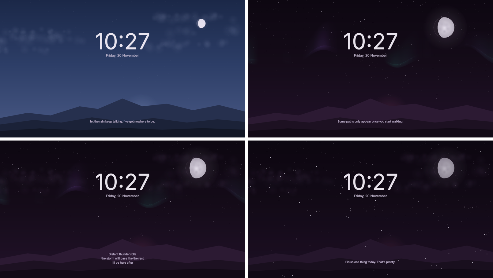
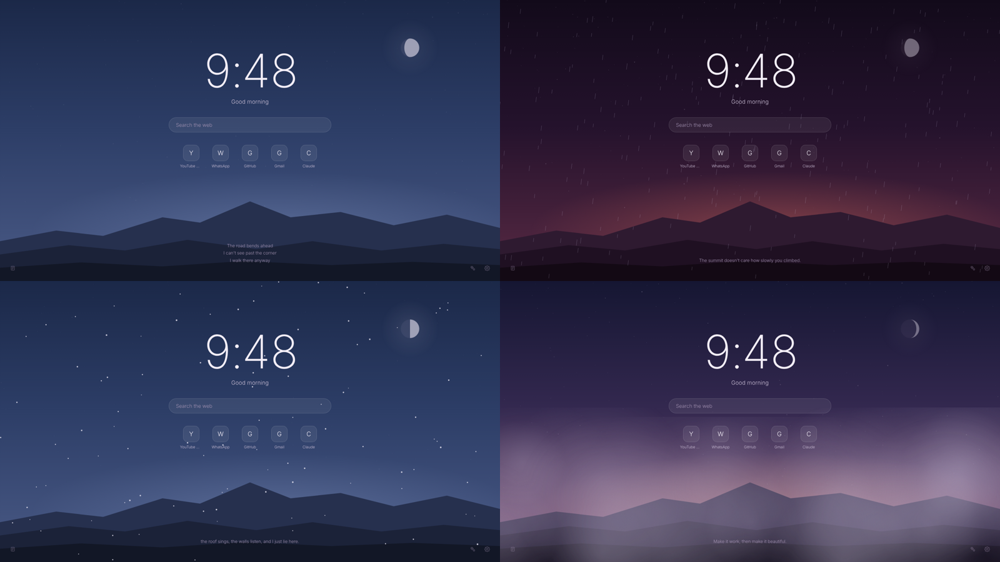
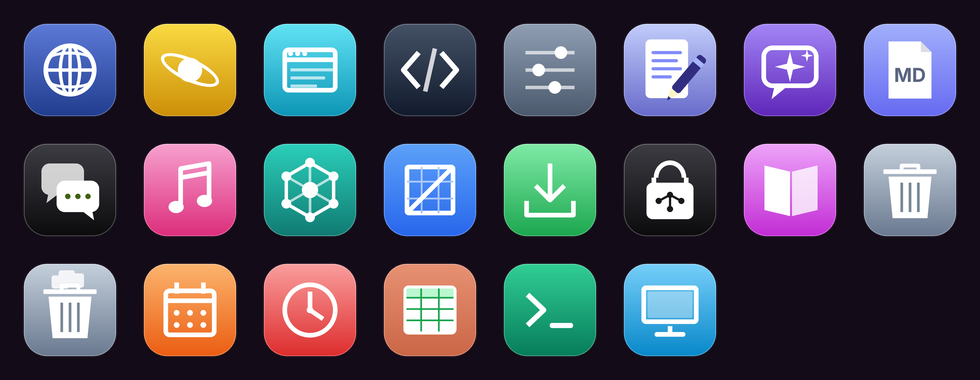

# Nightfall Desktop

A calm, Mac-inspired night-sky setup for Windows 10: a desktop clock with tonight's real moon, a full-screen sky that appears when you step away, a matching browser new tab and theme, and a hand-made icon set. Everything is lightweight, needs nothing extra installed, and can be turned off or undone.



## What's inside

### Moon Clock
A small, transparent desktop widget, built from source on your own PC with the C# compiler that comes with Windows.


- Time, date, and tonight's moon phase
- **Tonight's constellation:** which one is best placed in your sky, where to look, and when
- **What's playing** from YouTube Music, Spotify, or anything in Windows' media controls
- Right-aligned, draggable, and click-through once locked
- **Taskbar:** centers your app icons like a dock, and makes the taskbar clear, blurred, or frosted (replaces TaskbarX and TranslucentTB)

### Away mode
When you're idle, your desktop icons hide first, then a full-screen night sky fades in. Any mouse movement or key press brings everything back.



- The **real moon**, from NASA's lunar maps, lit with tonight's actual phase

  
- Twinkling stars, shooting stars, and meteor showers
- **Real constellations** that fade in now and then, and the song you're listening to

  
- Weather that matches outside (rain, storm, snow, fog), sky colors that follow the time of day, drifting clouds, a soft aurora, and gentle parallax

  
- A quiet shimmer at the top of each hour, 250 poetic lines that change every minute, and an optional lock after a while
- Skips full-screen apps and games, and never locks while something is playing

### Nightfall Tab
A new tab page for Brave or any Chromium browser.


- A big clock, search, and quick links with site icons
- An animated starfield, meteor showers on demand (press **M**), and real constellations
- Draw your own constellations by clicking stars
- Live weather, the real moon phase, and sky colors through the day

  
- A tiny, see-through daily to-do and notes panel

### Nightfall Theme
Deep plum and lavender browser colors to match the new tab.

### Icons
A matching set of rounded icons for folders, apps, This PC, Recycle Bin, and more, with a script that applies them all, including large Start menu tiles.



### Tweaks
- Remove the shortcut arrows from desktop icons (with an undo)

## Install

Requires Windows 10 and Brave (or another Chromium browser). Each part works on its own.

**Easiest:** download this repo (Code → Download ZIP), extract it, and double-click **restore.bat**. It asks before each part.

**Or by hand:**

| Part | How |
|---|---|
| Moon Clock | Copy `moon-clock` to `C:\Moon Clock` and double-click `build.bat`. Right-click the moon in the tray for options. |
| Nightfall Tab | `brave://extensions` → turn on Developer mode → **Load unpacked** → pick the `nightfall-tab` folder. |
| Nightfall Theme | Same as above, with the `nightfall-theme` folder. |
| Icons | Double-click `icons\apply-icons.bat`. Undo with `undo-icons.bat`. |
| Shortcut arrows | Double-click `tweaks\remove-arrows.bat`. Undo with `restore-arrows.bat`. |

If you used TaskbarX or TranslucentTB before, quit them first, since Moon Clock now does both jobs.

## Keeping it backed up

- **backup.bat** copies your current setup from your PC into this folder, then commits and pushes to GitHub if Git is set up. It never copies your personal settings (city, clock position, notes) or the compiled `.exe`.
- **restore.bat** puts everything back onto a PC, asking before each part.

To connect this folder to GitHub once, use [GitHub Desktop](https://desktop.github.com/) (File → Add local repository), or with Git:

```
git init
git add -A
git commit -m "First backup"
git branch -M main
git remote add origin https://github.com/mayank-singh-io/nightfall-desktop.git
git push -u origin main
```

After that, running **backup.bat** uploads changes automatically.

## Credits

- Moon surface: NASA's Scientific Visualization Studio, [CGI Moon Kit](https://svs.gsfc.nasa.gov/4720), from Lunar Reconnaissance Orbiter data
- Weather and sunrise times: [Open-Meteo](https://open-meteo.com/)
- New tab font: Sora, via Google Fonts

## License

Code and original icons are under the MIT License (see `LICENSE`). The moon image is NASA's, credited above.
