# Nightfall Desktop

**See it live:** https://mayank-singh-io.github.io/Nightfall-Desktop/

A calm, Mac-inspired night-sky setup for Windows 10: a desktop clock with tonight's real moon, a full-screen sky that appears when you step away, and a matching new tab page and browser theme. Everything is lightweight, needs nothing extra installed, and can be turned off or undone.

**Quick install** (open PowerShell and paste):

```powershell
irm https://raw.githubusercontent.com/mayank-singh-io/Nightfall-Desktop/main/install.ps1 | iex
```

Or grab the zip from the [latest release](https://github.com/mayank-singh-io/Nightfall-Desktop/releases/latest). See [Install](#install) for all options, and the [changelog](CHANGELOG.md) for what's new.


## What's inside

### Moon Clock
A small, transparent desktop widget, built from source on your own PC with the C# compiler that comes with Windows.

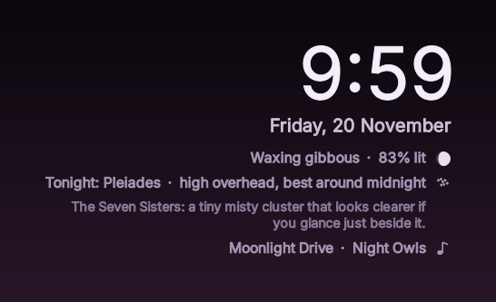

- Time, date, and tonight's moon phase
- **Tonight's constellation:** which one is best placed in your sky, where to look, and when
- **What's playing** from YouTube Music, Spotify, or anything in Windows' media controls
- Right-aligned, draggable, and click-through once locked
- **Taskbar:** centers your app icons like a dock, and makes the taskbar clear, blurred, or frosted (replaces TaskbarX and TranslucentTB)

**Settings** are grouped into tabs, and scenes are chosen from a grid of previews:

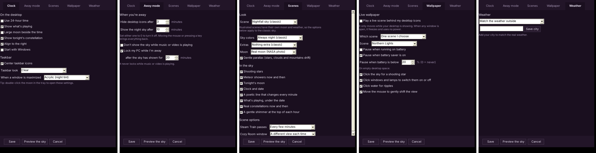

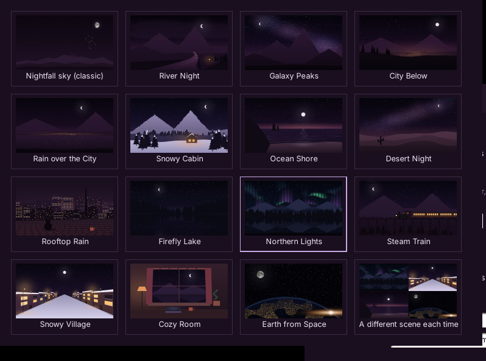

### Away mode
When you're idle, your desktop icons hide first, then a full-screen night sky fades in. Any mouse movement or key press brings everything back.


- The **real moon**, from NASA's lunar maps, lit with tonight's actual phase

  
- Twinkling stars, shooting stars, and meteor showers
- **Real constellations** that fade in now and then, and the song you're listening to

  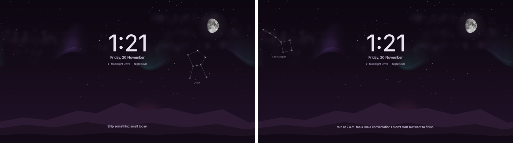
- Weather that matches outside (rain, storm, snow, fog), sky colors that follow the time of day, drifting clouds, a soft aurora, and gentle parallax

  
- **10 live illustrated scenes:** River Night, Galaxy Peaks, City Below, Rain over the City, Snowy Cabin (falling snow, chimney smoke), Ocean Shore (waves rolling in, gliding seabirds, a bobbing boat light), Desert Night (sand drifting off the dunes), Rooftop Rain (sitting on a roof with a cat and a warm mug, city windows switching on and off), Firefly Lake, and Northern Lights (aurora curtains drifting behind the mountains). Pick one, or get a different one each time.

  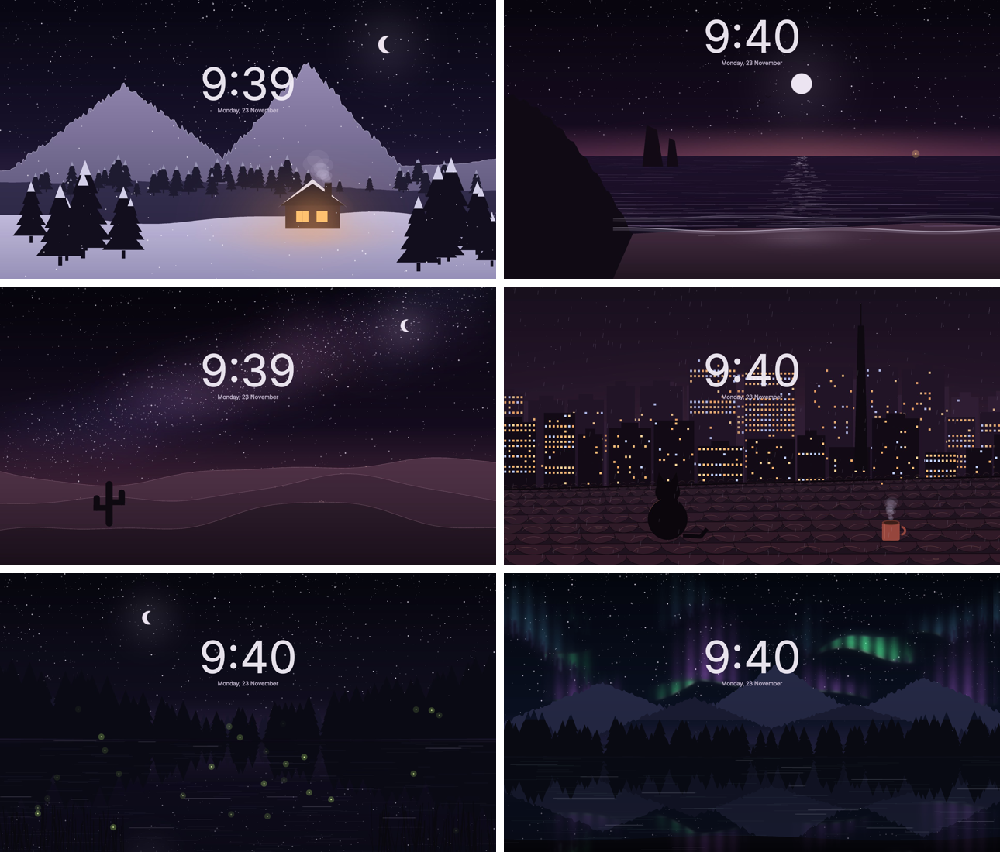
- **Four more:** a Steam Train crossing a stone viaduct (smoke trailing, wheels turning, firebox glowing), a Snowy Village seen from the street (chimney smoke, windows switching on and off), a Cozy Room with four window views to choose from (Rainy City with drops sliding down the glass, Mountain Lake, Snowy Forest, Beach and Sea), and Earth from Space (city lights turning below, aurora on the edge, satellites, and the occasional astronaut drifting by). That makes **14 scenes**.

  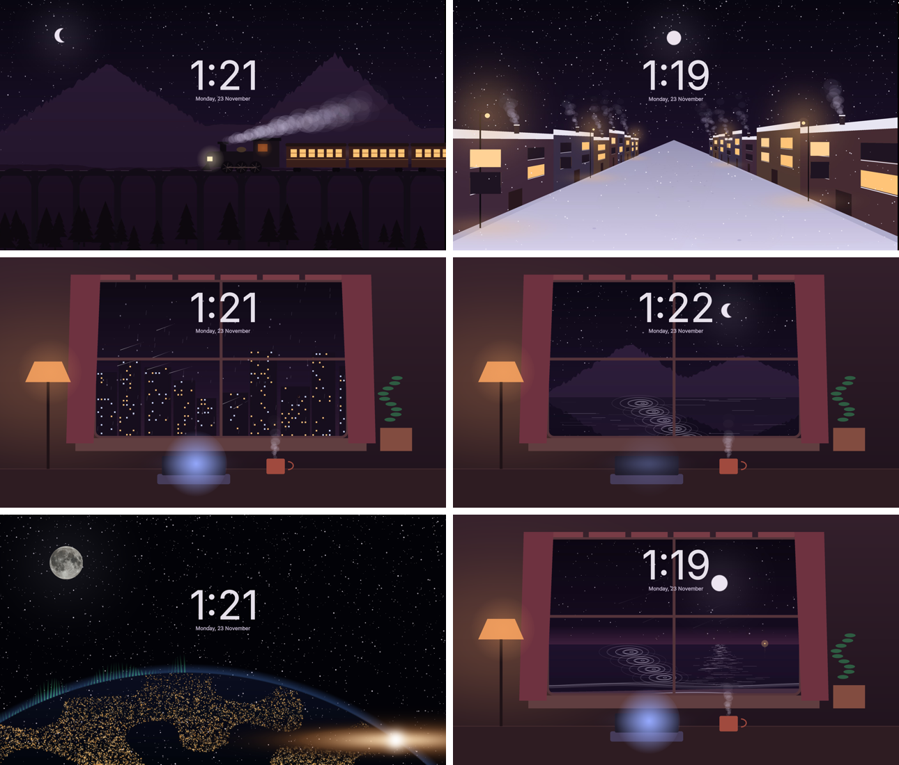
- **Nature scenes:** a Porch in the Forest (lantern light, steam from your mug, fireflies), a Moonlit Meadow (tall grass swaying in the wind), Wide Falls (streams pouring over a mossy ledge into a pool), and a Mountain Lake at Dawn (mist drifting over the water). That makes **18 scenes**.

  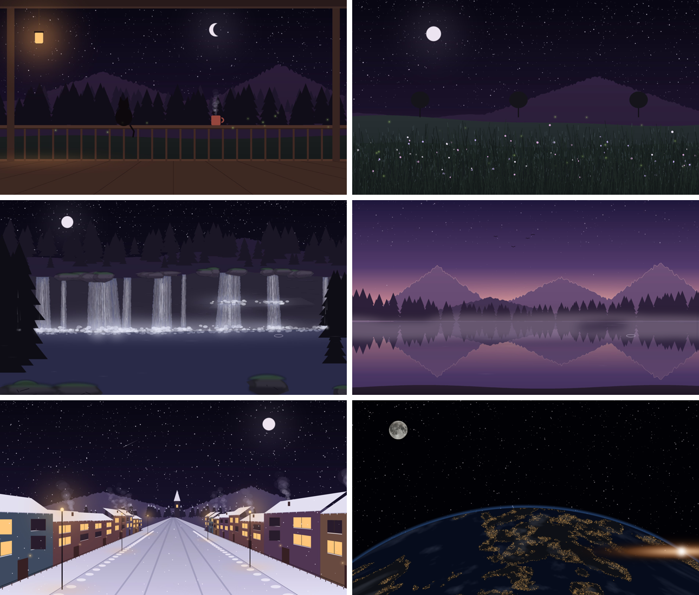
- **Special days:** lanterns and diyas on Diwali, colours on Holi, soft fireworks on New Year's Eve, and a little something on your birthday.
- **More than one screen:** a different scene on each, and you can save any scene as a 4K picture.
- **A real sky:** scenes follow the real weather where you are (rain, storms, snow, mist, clouds) and show tonight's real moon phase. When Windows starts, the night sky gently fades in.
- **Play:** hover to draw fireflies toward you, make stars sparkle and grass part; hold the sky for a meteor shower; click the moon for tonight's sky; catch a shooting star; draw your own constellations; double-click for rain or snow; and watch for rare surprises (a comet, an owl, a fox, a whale). Shooting stars leave sparkling trails: glittering dust, a glowing ribbon or sparkler sparks. Every bit can be switched off in the Play tab.
- **Dawn versions:** every scene turns to sunrise colours around the real sunrise where you are, worked out from your city with no internet needed. Choose in Settings: follow the sunrise, the sunrise and sunset, always night, or always dawn.

  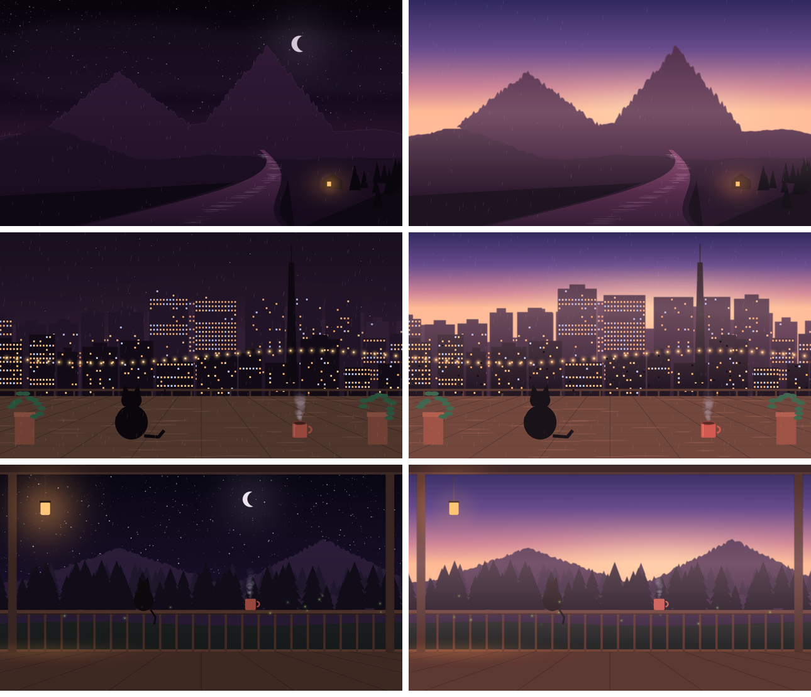

  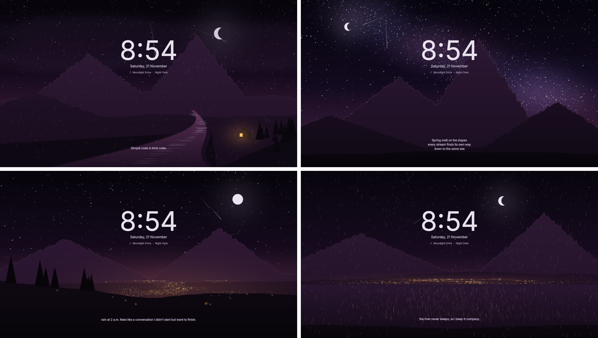
- A quiet shimmer at the top of each hour, and 250 poetic lines that change every minute
- Locks your PC after the sky has been up for 20 minutes, for safety. Change the time or turn it off in Settings.
- Skips full-screen apps and games, and never locks while something is playing

### Live wallpaper
Any of the 18 scenes can play behind your desktop icons. It only moves while your desktop is showing: open any window and it freezes in place, using no CPU. Choose one scene, a new one each day, or a new one each time you unlock, and pause it on battery, in battery saver, or below a battery level you set.

It's also interactive, on empty desktop space: click the sky for a shooting star, click windows and lamps to switch them on or off, click water for ripples, and move the mouse to gently shift the view. Each one has its own switch in Settings.

### Nightfall Tab
A new tab page for Brave or any Chromium browser.

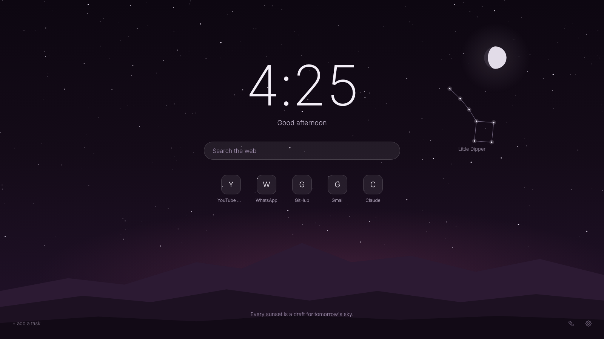

- A big clock, search, and quick links with site icons
- An animated starfield, meteor showers on demand (press **M**), and real constellations
- **All 18 live scenes** as your background, with dawn versions,: one you pick, or a different one each tab, with the same click-and-mouse interactions, each with its own switch

  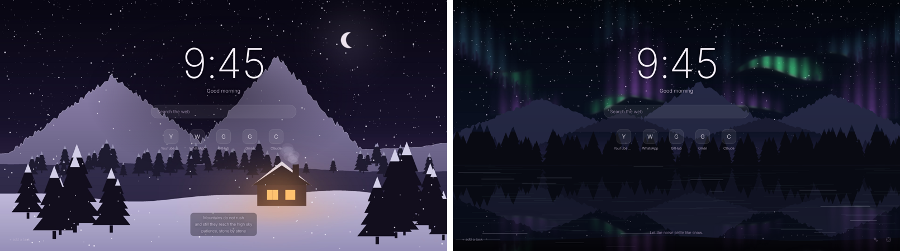
- Draw your own constellations by clicking stars
- Live weather, the real moon phase, and sky colors through the day

  
- A tiny, see-through daily to-do and notes panel

### Nightfall Theme
Deep plum and lavender browser colors to match the new tab.

### Tweaks
- Remove the shortcut arrows from desktop icons (with an undo)

## Requirements

- **Windows 10.** Everything works on any version; "what's playing" needs version 1809 or newer. Windows 11 isn't supported yet: its taskbar is built differently, so centering and transparency won't work there.
- **.NET Framework 4**, which comes with Windows 10, so there's nothing to install.
- **Brave, Chrome, Edge, or another Chromium browser** for the new tab page and theme.
- **Internet** only for weather, sunrise times, fonts, and site icons. Everything else works offline.

## What each part changes

Nothing is changed silently, and everything can be undone.

| Part | What it changes |
|---|---|
| **Moon Clock** | Files in `C:\Moon Clock`. The live wallpaper (off until you turn it on) draws behind your desktop icons and gives your normal wallpaper back when you turn it off or quit. The installer asks before turning on the taskbar changes. Settings in `%APPDATA%\NightfallMoonClock\settings.ini`. If you turn on "Start with Windows," an entry named `NightfallMoonClock` in your startup apps. While it runs, it can hide your desktop icons when you're away, move your taskbar icons to the center, and change the taskbar's transparency. All of these go back to normal when you quit it. |
| **Weather** (optional) | Your saved city's coordinates are sent to [Open-Meteo](https://open-meteo.com/) to get the weather and sunrise times. Nothing else leaves your PC. |
| **Nightfall Tab** | Replaces your browser's new tab page. Your sites, notes, and settings are stored in the browser on your PC only. |
| **Nightfall Theme** | Your browser's colors only. |
| **Shortcut arrows** | One Windows setting (the `29` value under `Explorer\Shell Icons`). `restore-arrows.bat` removes it. |

## Install

Requires Windows 10 and Brave (or another Chromium browser). Each part works on its own.

**One command:** open PowerShell and paste:

```powershell
irm https://raw.githubusercontent.com/mayank-singh-io/Nightfall-Desktop/main/install.ps1 | iex
```

It downloads this repo, asks which parts you want, builds the Moon Clock, and opens your browser's extensions page so you can add the new tab and theme (browsers require that last step by hand). It's always worth reading a script before running it: [install.ps1](install.ps1).

**To uninstall:**

```powershell
irm https://raw.githubusercontent.com/mayank-singh-io/Nightfall-Desktop/main/uninstall.ps1 | iex
```

**Or download it:** Code → Download ZIP, extract it, and double-click **restore.bat**. It asks before each part.

**Or by hand:**

| Part | How |
|---|---|
| Moon Clock | Copy `moon-clock` to `C:\Moon Clock` and double-click `build.bat`. Double-click the moon in the tray for Settings, or right-click it for quick options. |
| Nightfall Tab | `brave://extensions` → turn on Developer mode → **Load unpacked** → pick the `nightfall-tab` folder. |
| Nightfall Theme | Same as above, with the `nightfall-theme` folder. |
| Shortcut arrows | Double-click `tweaks\remove-arrows.bat`. Undo with `restore-arrows.bat`. |

If you used TaskbarX or TranslucentTB before, quit them first, since Moon Clock now does both jobs.

## Troubleshooting

**The build window says "That version didn't build... Building without 'what's playing'."**
Moon Clock still works, just without the song line. Open `build-log.txt` in the Moon Clock folder to see why, and [open an issue](https://github.com/mayank-singh-io/Nightfall-Desktop/issues) with its contents.

**Windows SmartScreen or my antivirus warns about MoonClock.exe.**
It's a brand-new program built on your own PC, so Windows hasn't seen it before. Click **More info → Run anyway**. You can read every line of its source in `moon-clock`.

**"What's playing" doesn't show anything.**
Check that **Show what's playing** is ticked in Settings → **Clock**, and that the music app shows up in Windows' own media controls (press a volume key and look for the song). Brave, Chrome, Spotify, and YouTube Music all do.

**My desktop icons are gone.**
Away mode hides them while you're idle, and they come back when you move the mouse. If they ever stay hidden (for example after a crash), quit and restart Moon Clock, or right-click the desktop → **View** → **Show desktop icons**.

**The taskbar icons aren't centered, or the taskbar isn't clear.**
Make sure TaskbarX and TranslucentTB are closed, since they fight over the taskbar. Then check **Center taskbar icons** and **Taskbar look** in Settings → **Clock**. These only work on Windows 10.

**Where are the settings?**
Double-click the moon in the system tray (or right-click it → **Settings...**). They're grouped into tabs: Clock, Away mode, Scenes, Wallpaper, and Weather. **Ctrl+Tab** moves between tabs, **Enter** saves, and **Esc** cancels.

**Desktop icons show black squares after removing shortcut arrows.**
Restart your PC once. If they're still there, run `tweaks\restore-arrows.bat`.

**The new tab page or theme won't load.**
In `brave://extensions` (or `chrome://extensions`), turn on **Developer mode**, click **Load unpacked**, and pick the folder that contains `manifest.json`.

**How much does it slow my PC down?**
Very little. The clock uses about 20–40 MB of memory and almost no CPU. The away-mode sky and the live wallpaper each use a few percent of CPU while they're actually visible, and nothing otherwise: the wallpaper freezes whenever a window is open.

**How do I remove everything?**
Run the uninstall command under [Install](#install). It closes Moon Clock properly, removes it from startup, and asks before deleting each folder.

## Backing up your own setup

- **backup.bat** copies your current setup from your PC into this folder, then commits and pushes to GitHub if Git is set up. It never copies your personal settings (city, clock position, notes) or the compiled `.exe`.
- **restore.bat** puts everything back onto a PC, asking before each part.

To connect this folder to GitHub once, use [GitHub Desktop](https://desktop.github.com/) (File → Add local repository), or with Git:

```
git init
git add -A
git commit -m "First backup"
git branch -M main
git remote add origin https://github.com/mayank-singh-io/Nightfall-Desktop.git
git push -u origin main
```

After that, running **backup.bat** uploads changes automatically.

## Credits

- Moon surface: NASA's Scientific Visualization Studio, [CGI Moon Kit](https://svs.gsfc.nasa.gov/4720), from Lunar Reconnaissance Orbiter data
- Weather and sunrise times: [Open-Meteo](https://open-meteo.com/)
- New tab font: Sora, via Google Fonts

## License

Nightfall Desktop is under the [PolyForm Noncommercial License 1.0.0](https://polyformproject.org/licenses/noncommercial/1.0.0/) (see `LICENSE`).

- **You can:** use it, install it, change it for yourself, and share it with others, for any noncommercial purpose.
- **You can't:** sell it, include it in a paid product, or use it for commercial purposes.
- **Always:** keep the copyright notice and the license with any copy you share.

For commercial use, [open an issue](https://github.com/mayank-singh-io/Nightfall-Desktop/issues) to ask.

The moon image is NASA's, credited above, and isn't covered by this license.
